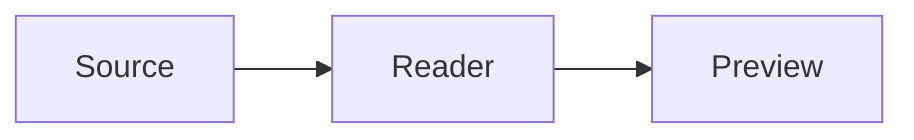

# Reader Visual Showcase

这是一份用于检查 Reader Typora 化显示效果的视觉基线文档。正文应当安静、清晰，并保持稳定的阅读宽度。

## Inline styles

Text can be **bold**, *italic*, ~~deleted~~, linked to [Reader](https://example.com), or contain `inline code`.

> A restrained blockquote should use a thin rule and avoid looking like a large card.

- First list item
- Nested formatting with ***bold italic***
- [ ] Pending task
- [x] Completed task

## Code and math

Inline math: $E = mc^2$.

$$
\int_0^1 x^2 dx = \frac{1}{3}
$$

```ts
interface Theme {
  name: string;
  mode: 'light' | 'dark';
}
```

## Diagram and table



| Element | Expected style |
| :--- | :--- |
| Heading | Clean, borderless |
| Table | Thin dividers |
| Code | Flat background |

## Image


End of visual fixture.
