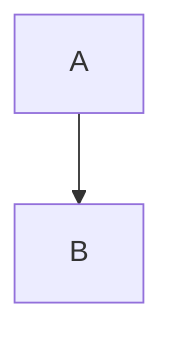

# WYSIWYM fixture

Nested ***bold italic*** and `inline code`.


Inline math $E = mc^2$.

$$
\int_0^1 x^2 dx
$$

- [ ] pending
- [X] complete

```ts
const answer = 42;
```



| Name | Value |
| :--- | ---: |
| alpha | 1 |
